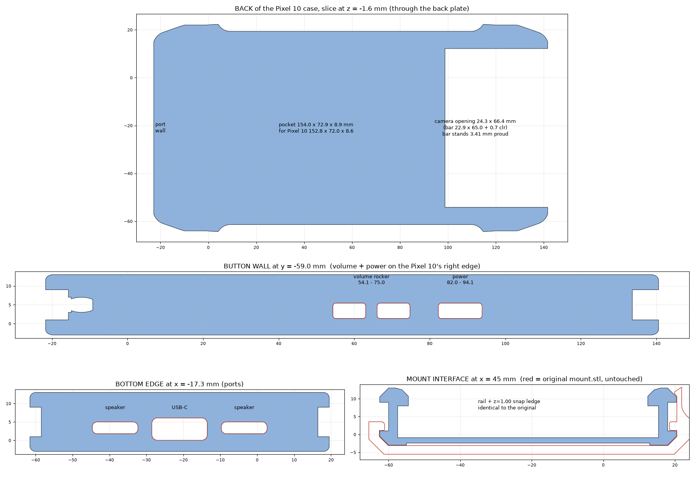

# Pixel 10 — Juggernaut MOLLE case

Phone: **152.80 × 72.00 × 8.60 mm**, camera bar **65.0 × 22.9 mm pill standing 3.41 mm proud**,
power and volume both on the right edge, **two speaker grilles** either side of the USB-C.

## Built from the Pixel 9 Pro kit

The Pixel 10 has the 9 Pro's exact footprint (152.8 × 72.0), so this kit is **derived from the
finished 9 Pro kit** rather than re-stretched from the S8 original. Everything the MOLLE adapter
and the end caps touch is inherited untouched: the +3.50 mm stretch, the rails, the side groove
and its z = 1.00 snap ledge, the re-trimmed rib, and both T-slots. Only what differs on the
phone was refilled with solid and then recut. See `source/pixel10/build10.py`.

## Source models — read this

Measured from **`Pixel10.stl`** by Jan Vejtasa ([Printables 1391738](https://www.printables.com/model/1391738),
GPL-3.0) and cross-checked against **`Google Pixel 10 Model.step`** by Jumpbase
([Printables 1538957](https://www.printables.com/model/1538957), CC BY-SA). Neither is
redistributed here; only measurements taken from them are.

| | Vejtasa STL | Jumpbase STEP | used |
|---|---|---|---|
| outline | 152.80 × 71.96 | 152.80 × 72.00 | 152.80 × 71.96 |
| thickness | **8.59** | 8.90 | 8.59 (Google's spec is 8.6) |
| camera bar | 64.96 × 22.88, top at 12.00 | 65.0 × 22.9, top at 12.30 | 3.41 mm proud (both agree) |
| bar position | 13.89 mm from the top edge | 13.90 mm | — |
| bottom ports | grille / USB-C / grille | the same, within 0.5 mm | Vejtasa |
| buttons | 0.50 mm proud, z 2.65–5.94 | 0.60 mm proud | Vejtasa |
| corner radius | **R 12** | **R 10** | pocket cut for R 10 (see below) |

The two models agree on everything except the corner radius and the STEP's thickness, which is
0.3 mm over Google's own figure. The STEP's author says it was a quick mock-up, so the STL wins
where they differ. **Neither model was measured from a real phone with calipers**, so the bottom
openings are cut oversize like the 9 Pro's.

## What changed from the Pixel 9 Pro kit

| # | Change | Reason |
|---|--------|--------|
| 1 | Pocket ceiling raised 0.10 mm to z = 8.00 → pocket **154.00 × 72.90 × 8.90 mm** | The phone is 8.6 mm, the 9 Pro 8.5. The phone still sits on the same floor (z = −0.90), with 0.30 mm over the screen. |
| 2 | Pocket corners recut at **R 10.45** (9 Pro: R 12.45) | The two reference models disagree (R 12 vs R 10). Cutting for R 10 fits either, and costs only 0.8 mm of extra gap in each corner if the real phone is R 12. |
| 3 | Camera opening **24.28 × 66.36 mm**, full-round ends, at x 99.28–123.56, y −54.18…12.18 | The bar is 1.4 mm longer (toward the bottom of the phone) and 0.5 mm wider than the 9 Pro's, plus 0.70 mm clearance all round. |
| 4 | Camera shelf widened by 0.25 mm each side and grown toward the bar, but **its −X end held at x = 97.49** | The MOLLE adapter's arms pass just below x 97.4. Extending the shelf the full 1.4 mm hit them (9.5 mm³), so the end goes vertical there. The rim around the opening at the shelf's outer face stays 1.0 mm, the same as the 9 Pro's. |
| 5 | Slide channel widened to the new opening, floor kept at z = −4.62 | The bar stands 3.41 mm proud, which leaves 0.31 mm over the channel floor. |
| 6 | Button wall refilled, then recut: volume x 54.06–75.05, power x 81.98–94.14, z 1.76–5.05 | About 1 mm lower down the side than the 9 Pro's, and 0.2 mm taller. New plungers to match. |
| 7 | Bottom wall refilled, then recut: **two speaker openings** (y −44.67…−32.29 and −9.71…2.67) and the same generous USB-C | The Pixel 10 has a grille on each side of the USB-C. The 9 Pro's mic and second hole are closed off. |
| 8 | Both bottom caps: the 9 Pro's holes closed, and **two rows of four slots** cut over the grilles | Same as above. The cable cap keeps the 9 Pro's single clean USB window. |
| 9 | Top cap: the 9 Pro's tongue widened to the new channel | It still adds **+0.0000 mm³** of interference over a full 26 mm withdrawal. |
| 10 | Lens cap rebuilt around the new shelf **and cut clear of the MOLLE adapter** (0.20 mm) | It now stays on while the case is in the adapter. The 9 Pro's lens cap overlaps the adapter's arms by 11.7 mm³; this one overlaps them by 0. |

The top mic (y −44.98…−43.69) falls inside the stock top cap's vent (y −46.54…−43.54), the
same as on the 9 Pro, so the top cap needs no new hole. It is 99.9 % open.

## Files

`case_pixel10.stl` · `top_cap_pixel10.stl` · `bottom_cap_pixel10.stl` ·
`bottom_cap_for_usb_cable_pixel10.stl` · `volume_button_pixel10.stl` ·
`power_button_pixel10.stl` · `camera_protector_cap_pixel10.stl`

The MOLLE adapter is `../shared-mount/mount.stl`, **unchanged**. The same printed adapter takes
the 9 Pro, 9a, 6a and Pixel 10 cases.

`assembly/` holds the coloured, fully assembled model (OBJ + 3MF). See `assembly/README.md`.

## Verified by boolean intersection (all 0.000 mm³ or float noise)

`source/pixel10/verify10_all.py` checks:

* case ∩ mount: the adapter still seats
* case ∩ phone seated, and shifted to every extreme of its clearance (±X, +Y, −Y to the relief, +Z)
* the phone slid in from the +X end in 2 mm steps over the full length, at five clearance corners
* case ∩ and phone ∩ both bottom caps, the top cap, and both plungers
* mount ∩ both plungers and the lens cap
* the camera bar's real outline extruded straight out through the back: nothing in the way
* both grilles and the USB-C 100 % open through the case. With caps on, the grilles are 87 %
  open; with the cable cap, the USB-C is 100 % open.
* a USB-C plug can be driven through the cable cap and case to the port: **13.0 × 4.75 mm**
  clear (the 9 Pro kit has 13.0 × 4.0)
* every STL is one body and watertight

## Thinnest features

Side walls 2.55 mm (2.20 mm across the button relief band) · back plate 1.50 mm (1.38 mm under
the slide channel, inside the shelf) · front lip 3.00 mm wide and 3.90 mm thick · ledge beside
the camera opening 3.25 mm · shelf wall at the −X end of the camera opening 1.79 mm at the back
plate, 1.0 mm at the outer face

## Printing

Case is **164.4 × 86.6 × 19.0 mm**, the same envelope as the 9 Pro's. Back (−Z) on the plate,
PETG or ABS/ASA, 4 perimeters, 30 % infill or more.

Print the plungers first and drop them in from inside the pocket. Then take the top cap off and
slide the phone in from the top. If it's tight, scale the case 100.3 % in X and Y only.

**Not yet test-printed against a real Pixel 10.** Every fit above is verified against the
reference models. The two numbers to check on a first print are the corner fit and the button
positions.
